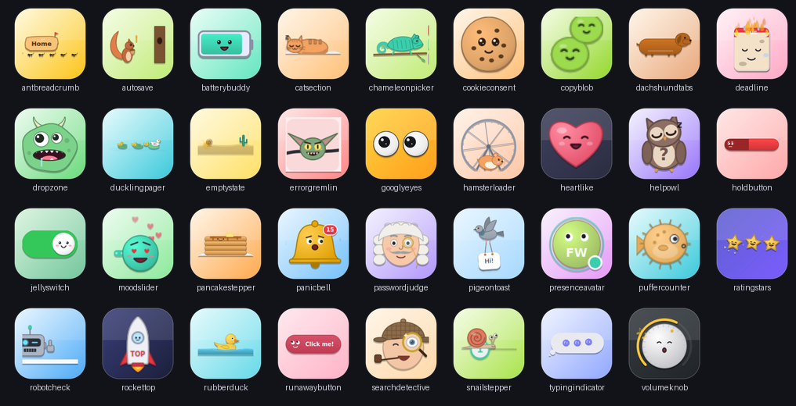
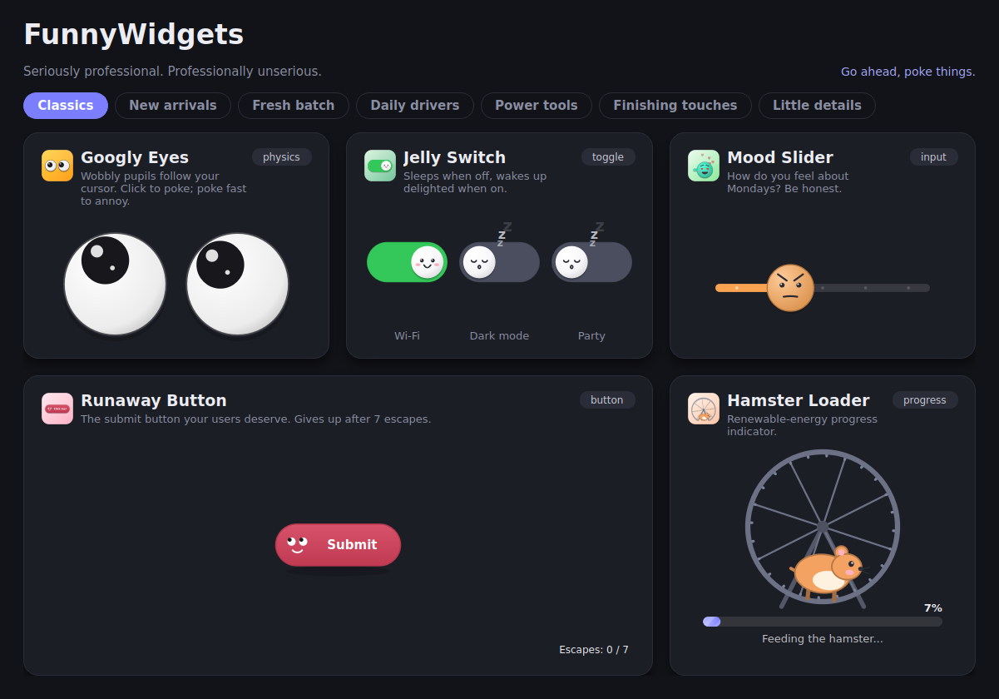
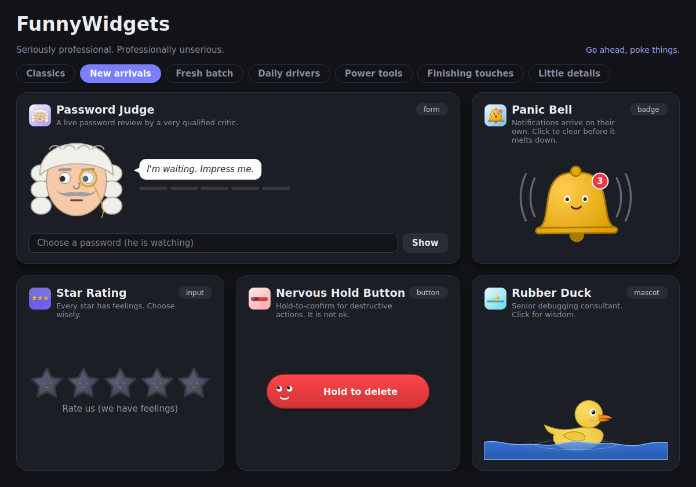
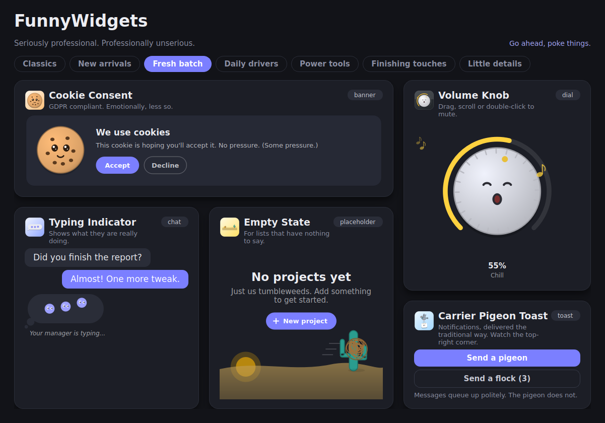
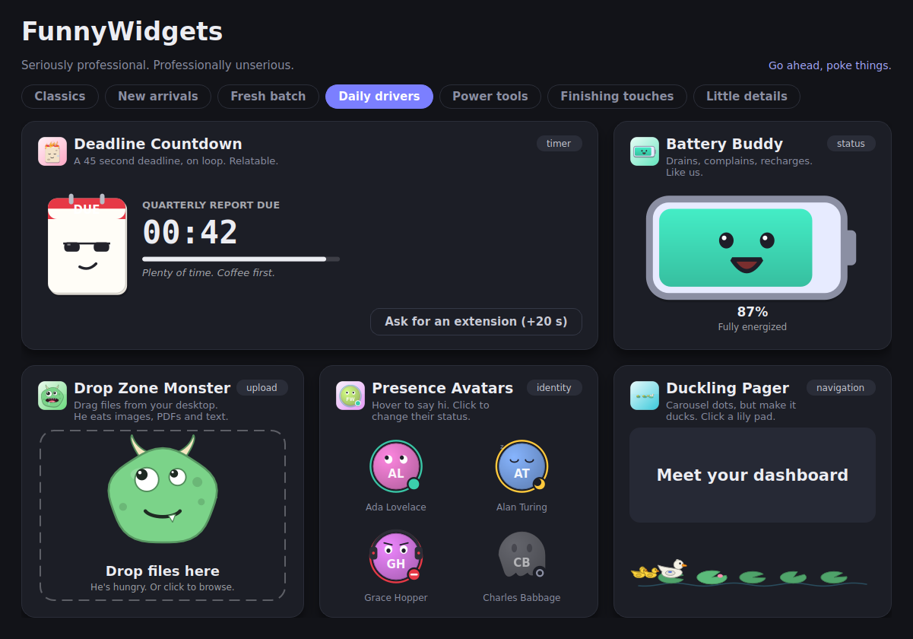
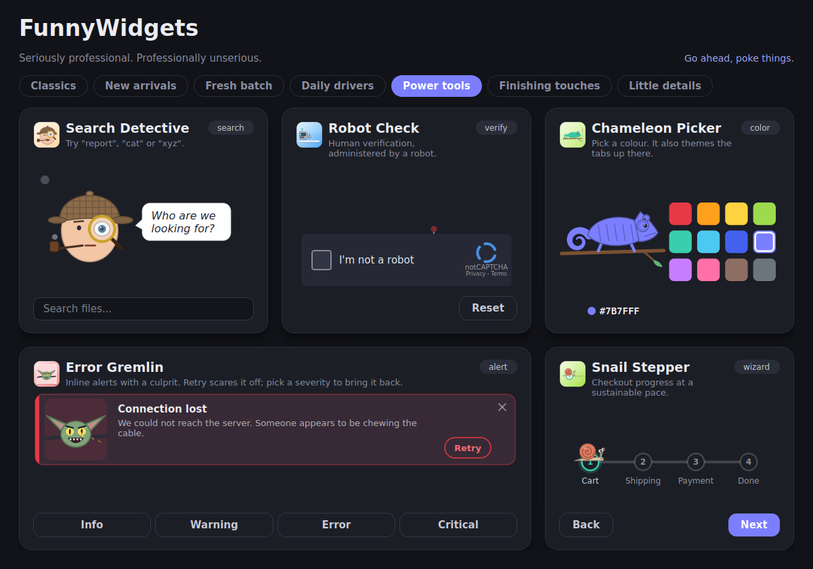
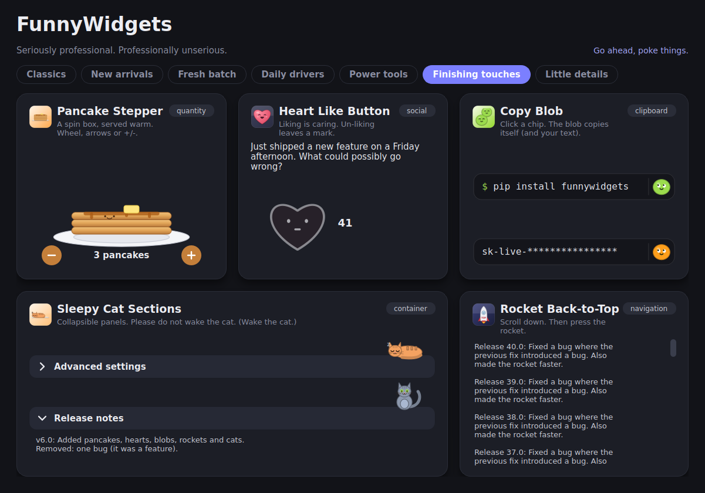
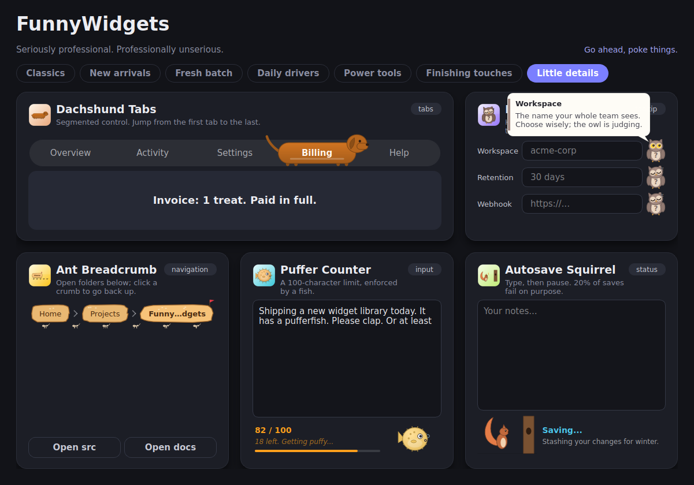

# QFunnyWidgets (C++ / Qt 6 & Qt 5)

[](https://github.com/Usama01TN/QFunnyWidgets/actions/workflows/release.yml)
[](LICENSE.md)

**Definition.** A library of 35 custom-painted, animated Qt widgets with a sense of humour. This is the C++ port of
the Python [QFunnyWidgets](https://github.com/Usama01TN/QFunnyWidgets) project: same widgets, same behaviour, same
looks, same demos, same gallery, same Qt Designer integration, for **Qt 6** and **Qt 5.15**.

**Goal.** Give serious applications a little personality: every widget is a drop-in, fully configurable `QWidget`
that behaves like a normal control (signals, properties, slots, keyboard support) but animates like a cartoon.
Plain Qt Widgets, nothing else.





<details>
<summary>More gallery pages</summary>








</details>

## Downloads:

Every [GitHub release](https://github.com/Usama01TN/QFunnyWidgets/releases) has ready-made packages for Qt 5 and
Qt 6 on every desktop architecture. Each build produces a **gallery** (self-contained, no Qt needed: try the widgets)
and an **SDK** (static library, headers, CMake package, Designer plugin, `funnywidgets-designer`):

| OS      | Architecture         | Qt 6 (6.10.3)                  | Qt 5                                        | Gallery format |
|---------|----------------------|--------------------------------|---------------------------------------------|----------------|
| Linux   | x86_64               | `linux-qt6-x86_64`             | `linux-qt5-x86_64` (Ubuntu 5.15.3)          | `.AppImage`    |
| Linux   | aarch64 (ARM64)      | `linux-qt6-aarch64`            | `linux-qt5-aarch64` (Ubuntu 5.15.3)         | `.AppImage`    |
| Windows | x64                  | `windows-qt6-x64` (MSVC)       | `windows-qt5-x64` (5.15.2, MSVC)            | `.zip`         |
| Windows | x86 (32-bit)         | -                              | `windows-qt5-x86` (5.15.2, MSVC)            | `.zip`         |
| Windows | arm64                | `windows-qt6-arm64` (MSVC)     | `windows-qt5-arm64-mingw` (MSYS2 5.15.19)   | `.zip`         |
| macOS   | Apple Silicon + Intel| `macos-qt6-universal`          | -                                           | `.dmg`         |
| macOS   | Apple Silicon        | (universal)                    | `macos-qt5-arm64` (Homebrew 5.15.17)        | `.dmg`         |
| macOS   | Intel                | (universal)                    | `macos-qt5-x86_64` (5.15.2)                 | `.dmg`         |

File names are `QFunnyWidgets-<version>-<column value>-gallery.<format>` and `...-sdk.(tar.gz|zip)`;
`SHA256SUMS.txt` lists the checksums.

- **Why some cells differ:** Qt 6 does not support 32-bit Windows, and The Qt Company never published open-source
  Qt 5 binaries for ARM64, so the ARM64 Qt 5 builds use the maintained Qt 5.15 builds of Ubuntu, MSYS2 and Homebrew.
- **Using an SDK:** link it with the same Qt it was built with (the version in the table; on Windows the same
  compiler family: MSVC Release, or MSYS2 CLANGARM64 for the `-mingw` package). Otherwise build from source, which
  takes a minute.
- **macOS:** the apps are ad-hoc signed, not notarized: the first time, right-click the app and choose *Open*.

## Quick start:

```bash
cmake -S . -B build                      # uses Qt 6 if found, otherwise Qt 5
cmake --build build -j
./build/funnywidgets-mainwindow          # the gallery of all 35 widgets
./build/funnywidgets-jellyswitch         # one demo per widget (funnywidgets-<package>)
```

```cpp
#include "jellyswitch/jellyswitch.h"

JellySwitchWidget::Options o;           // every Python keyword argument is a field, same name, same default
o.checked = true;
o.onColor = QColor("#5E60CE");
o.toggled = [](bool on) { qDebug() << "switched" << on; };   // callbacks are connected to the signal
auto *sw = new JellySwitchWidget(o, parent);

sw->setWobbliness(0.9);                 // every option is also a getter/setter pair (setters are slots)...
sw->setProperty("onColor", QColor("#FF4D6D"));   // ...and a Q_PROPERTY
connect(sw, &JellySwitchWidget::toggled, this, &MyWindow::onToggled);   // ...and every event is a signal
```

## Contents:

### Interactive controls:

| Package           | Class                        | What it does                                                                                                                                                                                                                                              |
|-------------------|------------------------------|-----------------------------------------------------------------------------------------------------------------------------------------------------------------------------------------------------------------------------------------------------------|
| `jellyswitch`     | `JellySwitchWidget`          | Toggle switch whose jelly knob has a face: sleeps with floating "z" when off, wakes up blushing when on, squashes when pressed and wobbles as it slides.                                                                                                  |
| `moodslider`      | `MoodSliderWidget`           | Slider whose thumb is a face that goes from furious (red, shaking, steaming) to ecstatic (heart eyes, floating hearts). Tilts with drag speed, shows a mood bubble.                                                                                       |
| `runawaybutton`   | `RunawayButtonWidget`        | A button that dodges the cursor with springy squash & stretch and taunts you; after `maxEscapes` it gets tired, sweats and lets you click it (confetti).                                                                                                  |
| `ratingstars`     | `StarRatingWidget`           | Star rating where every star has a face: hover previews the mood, clicks send a bounce wave, 1 star makes the others cry, 5 stars makes them all dance.                                                                                                   |
| `holdbutton`      | `NervousHoldButtonWidget`    | Hold-to-confirm button for destructive actions. Fills while held, shakes and sweats more with each stage ("Are you sure?"), sighs "Phew!" if released early, faints when confirmed.                                                                       |
| `volumeknob`      | `VolumeKnobWidget`           | Rotary volume dial with a face: zipped mouth when muted, hums and sings (floating notes) at mid volume, squints with sound waves when loud, screams and turns red at 100 %. Drag, wheel, arrows, double-click or M to mute.                               |
| `dropzone`        | `DropZoneMonsterWidget`      | Real drag-and-drop upload zone guarded by a hungry monster: opens wide and drools when files hover, chomps and burps when they drop, sticks its tongue out at unaccepted extensions. Click to browse.                                                     |
| `ducklingpager`   | `DucklingPagerWidget`        | Carousel page indicator: pages are lily pads, mother duck swims to the current one with her ducklings in tow and quacks on arrival. Click, wheel or arrow keys.                                                                                           |
| `searchdetective` | `SearchDetectiveWidget`      | Debounced search field with a deerstalker detective: pipe smoke while idle, sweeping magnifier while typing, "Elementary!" on results, a personal rain cloud on none. Emits `searchRequested`; report with `setResultCount()` or pass a `searchFunction`. |
| `robotcheck`      | `RobotCheckWidget`           | "I'm not a robot" box with a robot hiding behind it: pops up sweating oil during the check, winks and gives a thumbs-up when you pass. Optional `failChance`.                                                                                             |
| `chameleonpicker` | `ChameleonColorPickerWidget` | Swatch color picker: the chameleon's eyes move independently, its tongue grabs the chosen color, and the color washes over it from head to tail.                                                                                                          |
| `snailstepper`    | `SnailStepperWidget`         | Wizard / checkout step indicator: a snail carries progress between steps at a strictly limited pace, leaving a glistening slime trail and complaining when rushed.                                                                                        |
| `pancakestepper`  | `PancakeStepperWidget`       | Quantity input (spin box) as a pancake stack: "+" drops one on with a squash, "-" flips the top one off; butter and syrup on top; it wobbles near the maximum and refuses more.                                                                           |
| `heartlike`       | `HeartLikeButtonWidget`      | Like button: liking pops the heart with a burst of mini hearts and a heartbeat; un-liking cracks it (then a bandage); toggling too fast makes it dizzy. Odometer-style counter.                                                                           |
| `copyblob`        | `CopyBlobButtonWidget`       | Copy-to-clipboard chip for commands, keys or codes: the blob mascot splits in two and the clone hops into the clipboard. Shows a masked label while copying the real text.                                                                                |
| `rockettop`       | `RocketBackToTop`            | Back-to-top button for any scroll area: appears after a threshold, launches with flame and smoke while smoothly scrolling up, returns by parachute. Only the rocket takes clicks.                                                                         |
| `dachshundtabs`   | `DachshundTabsWidget`        | Segmented control / tab bar whose selection highlight is a dachshund: the front end runs ahead, the body stretches across the tabs, the rear catches up.                                                                                                  |
| `puffercounter`   | `PufferCounterWidget`        | Text area with a character limit and a pufferfish that inflates as you approach it, grows spikes, and turns red and furious past it. Optional hard limit.                                                                                                 |
| `helpowl`         | `HelpOwlWidget`              | Inline "?" help icon that is a sleeping owl: hover and it wakes, swivels its head and shows a floating help bubble (flips side near window edges). Click to pin.                                                                                          |
| `antbreadcrumb`   | `AntBreadcrumbWidget`        | Breadcrumb navigation of real bread crumbs: ants march underneath, carry away crumbs when you go up and carry in new ones when you go deeper.                                                                                                             |
| `passwordjudge`   | `PasswordJudgeWidget`        | Password field reviewed live by a powdered-wig judge: eyes follow the text cursor, monocle pops off at bad passwords, strength meter, covers his eyes on "Show". `JudgeFaceWidget` and `passwordStrength()` are usable on their own.                      |

### Feedback & indicators:

| Package           | Class                     | What it does                                                                                                                                                                                                           |
|-------------------|---------------------------|------------------------------------------------------------------------------------------------------------------------------------------------------------------------------------------------------------------------|
| `typingindicator` | `TypingIndicatorWidget`   | Chat "..." indicator whose dots are creatures: bouncing (Typing), staring up with a "?" (Thinking), vibrating while vanishing one by one (Deleting) or snoozing (Sleeping). `autoCycle` simulates an indecisive human. |
| `pigeontoast`     | `PigeonToast`             | Toast overlay for any widget: a flapping carrier pigeon flies in with your message on a swinging banner, drops a few feathers and flies off. Queued, mouse-transparent, follows the parent's size.                     |
| `autosave`        | `AutosaveSquirrelWidget`  | Autosave status with built-in debounce and retry: the squirrel naps (saved), sits up (unsaved), stashes acorns (saving) or drops one and facepalms (error). Shows "Saved 2 min ago".                                   |
| `batterybuddy`    | `BatteryBuddyWidget`      | Battery indicator that bounces when full, yawns when low, sweats and slumps near empty, flickers at 3 % and happily munches electricity while charging. Emits `lowBattery()`.                                          |
| `deadline`        | `DeadlineCountdownWidget` | Countdown timer hosted by a tear-off calendar: sunglasses with plenty of time, focus, sweat, shaking red panic, and calmly on fire ("This is fine") when overdue. `extend()` brings relief.                            |
| `panicbell`       | `PanicBellWidget`         | Notification bell that naps at 0, swings and dings on new items, sweats past `panicThreshold`, melts down at "99+" (spiral eyes, alarm glow). Click to clear; it sighs with relief.                                    |
| `hamsterloader`   | `HamsterLoaderWidget`     | Progress indicator powered by a hamster in a wheel. Runs faster as progress grows, sweats past 60 %, cycles silly status messages, celebrates at 100 %. Indeterminate mode with `progress < 0`.                        |

### Banners & placeholders:

| Package         | Class                 | What it does                                                                                                                                                                                                                |
|-----------------|-----------------------|-----------------------------------------------------------------------------------------------------------------------------------------------------------------------------------------------------------------------------|
| `errorgremlin`  | `ErrorGremlinWidget`  | Inline alert banner whose gremlin matches the severity: napping (Info), peeking with a wrench (Warning), chewing a cable with sparks (Error), bouncing in front of a fire (Critical). Retry scares it off; close fades out. |
| `cookieconsent` | `CookieConsentWidget` | Cookie banner starring a cookie: hopeful puppy eyes, excited when you hover Accept, lip quivering at Decline. Accepted, it is eaten in three bites with crumbs; declined, it sobs.                                          |
| `emptystate`    | `EmptyStateWidget`    | "Nothing here yet" placeholder in a tiny desert: bouncing tumbleweed, bored cactus, chirping crickets and a call-to-action button.                                                                                          |

### Containers:

| Package      | Class                    | What it does                                                                                                                                                                                 |
|--------------|--------------------------|----------------------------------------------------------------------------------------------------------------------------------------------------------------------------------------------|
| `catsection` | `SleepyCatSectionWidget` | Collapsible section with animated height and a cat on the header: asleep when collapsed, startled awake on expand, yawning on collapse. Holds any widget. `CatHeaderWidget` is usable alone. |

### Identity:

| Package          | Class                  | What it does                                                                                                                                                                            |
|------------------|------------------------|-----------------------------------------------------------------------------------------------------------------------------------------------------------------------------------------|
| `presenceavatar` | `PresenceAvatarWidget` | Initials avatar with a name-derived color whose presence status is its mood: online (eyes follow you), away (dozing, moon badge), busy (headphones, frown), offline (a floating ghost). |

### Decorative / mascots:

| Package      | Class              | What it does                                                                                                                                                   |
|--------------|--------------------|----------------------------------------------------------------------------------------------------------------------------------------------------------------|
| `googlyeyes` | `GooglyEyesWidget` | Googly eyes with real spring + gravity physics that follow the cursor anywhere on screen, blink, spin dizzy when poked and get angry if poked 3 times quickly. |
| `rubberduck` | `RubberDuckWidget` | Rubber-duck-debugging companion bobbing on water. Squeaks on click and dispenses dev advice; `listen(text)` makes it nod thoughtfully before answering.        |

## Key features:

- 60 fps animation driven by `QTimer` + `QElapsedTimer` (frame-rate independent physics); timers stop when the widget is
  hidden.
- Everything painted with `QPainter` and antialiasing, scales cleanly to any size.
- Every option is an `Options` field, a `getX()/setX()` pair (setters are slots) and a `Q_PROPERTY`.
- Every event is a Qt signal; each signal can also be given as a `std::function` in `Options`
  (`o.toggled = [this](bool on) { ... };`), exactly like the Python callable keyword arguments.
- Painted text follows the palette, so widgets work on light and dark themes.
- Each package is standalone: copy one folder (`<package>/<package>.h/.cpp`) into your project and it works. No shared
  helper headers.
- One code base for Qt 6 and Qt 5.15, no deprecated APIs (builds warning-free on both).
- Every widget ships its own icon, `<package>/logo.png`, compiled in as the Qt resource
  `:/QFunnyWidgets/<package>/logo.png` through `<package>/<package>.qrc`.
- A Qt Designer plugin for 33 widgets (`funnywidgetsplugin`), plus a `funnywidgets-designer` launcher.

## Layout:

```
CMakeLists.txt                  builds everything (library, demos, gallery, tools, Designer plugin, smoke test)
QFunnyWidgets.pri               qmake include file for the library sources
QFunnyWidgets/
  QFunnyWidgets.h               includes every widget (the counterpart of __init__.py)
  mainwindow.h/.cpp, main.cpp   the gallery (funnywidgets-mainwindow)
  makelogos.cpp                 regenerates every <package>/logo.png (funnywidgets-makelogos)
  designer.cpp                  launches Qt Designer with the plugin (funnywidgets-designer)
  <package>/
    <package>.h/.cpp            the widget(s)
    mainwindow.h/.cpp, main.cpp the demo (namespace <package>, executable funnywidgets-<package>)
    logo.png, <package>.qrc     the icon
plugins/
  funnywidgetsinfo.h/.cpp       Designer metadata + factory for the 33 Designer widgets
  funnywidgetsplugin.h/.cpp     QDesignerCustomWidgetCollectionInterface plugin
tests/
  smoke.cpp                     headless smoke test (funnywidgets-smoke, registered with CTest)
docs/                           screenshots
packaging/linux/                desktop entry for the AppImage
.github/workflows/release.yml   CI + releases (Linux, Windows, macOS)
.github/scripts/                package-linux.sh, package-windows.sh, package-macos.sh
```

## Requirements:

- A C++17 compiler.
- Qt 6 or Qt 5.15: the `Widgets` module; `UiPlugin` for the Designer plugin. Tested locally with Qt 6.4.2 and
  5.15.13; CI builds Qt 6.10.3, 5.15.2 (official), 5.15.3 (Ubuntu), 5.15.17 (Homebrew) and 5.15.19 (MSYS2).
- CMake 3.16 or newer (or qmake through `QFunnyWidgets.pri`).

## Build options:

| CMake option                       | Default | Meaning                                                              |
|------------------------------------|---------|----------------------------------------------------------------------|
| `QFW_QT_MAJOR`                     | empty   | `5` or `6` to force a Qt major version; empty = Qt 6 if found, else 5 |
| `QFW_BUILD_DEMOS`                  | `ON`    | one `funnywidgets-<package>` demo per widget                         |
| `QFW_BUILD_GALLERY`                | `ON`    | `funnywidgets-mainwindow`                                            |
| `QFW_BUILD_TOOLS`                  | `ON`    | `funnywidgets-makelogos` and `funnywidgets-designer`                 |
| `QFW_BUILD_TESTS`                  | `ON`    | `funnywidgets-smoke` (+ `ctest`)                                     |
| `QFW_BUILD_DESIGNER_PLUGIN`        | `ON`    | `funnywidgetsplugin` (skipped automatically without Qt `UiPlugin`)   |

The library target is `QFunnyWidgets` (alias `QFunnyWidgets::QFunnyWidgets`), a position-independent static library.
To use it from your own CMake project:

```cmake
add_subdirectory(QFunnyWidgets)                 # this repository
target_link_libraries(myapp PRIVATE QFunnyWidgets::QFunnyWidgets)
```

Or install it and use `find_package`:

```bash
cmake -S . -B build -DCMAKE_INSTALL_PREFIX=/opt/qfunnywidgets && cmake --build build && cmake --install build
```

```cmake
find_package(QFunnyWidgets REQUIRED)             # with CMAKE_PREFIX_PATH=/opt/qfunnywidgets
target_link_libraries(myapp PRIVATE QFunnyWidgets::QFunnyWidgets)
```

The install also places the gallery in `bin/` and the Designer plugin in `lib/qt<N>/plugins/designer/`.

Include either the aggregate header `#include "QFunnyWidgets.h"` or a single widget,
`#include "jellyswitch/jellyswitch.h"`. With qmake, add `include(path/to/QFunnyWidgets.pri)` to your `.pro`.

## Run:

```bash
./build/funnywidgets-mainwindow                  # gallery
./build/funnywidgets-<package>                   # e.g. funnywidgets-googlyeyes
ctest --test-dir build --output-on-failure       # headless smoke test (all demos + Designer metadata)
./build/funnywidgets-makelogos [size] [dir]      # regenerate the logos (then rebuild: they are resources)
```

## Qt Designer:

The `funnywidgetsplugin` target builds `build/designer/libfunnywidgetsplugin.so` (`.dll` / `.dylib`), a widget
collection with the same 33 widgets, groups, tool tips, icons and default sizes as the Python plugins.
`PigeonToast` and `RocketBackToTop` are runtime overlays (they attach to a parent or a scroll area at construction),
so, as in the Python version, they are created in code rather than placed in Designer.

- `./build/funnywidgets-designer` starts the Designer of the same Qt version with `QT_PLUGIN_PATH` pointing at the
  build directory (`--print-env` shows the environment, `--plugins-path` the plugin directory).
- Or copy the library into Designer's own `plugins/designer` directory.
- Forms using the widgets compile with `uic` as usual: the generated code includes `<package>/<package>.h`, so add the
  `QFunnyWidgets` source directory to your include path (linking `QFunnyWidgets::QFunnyWidgets` does that).

Designer must be built with the same Qt version (and compiler) as the plugin.

## Mapping from the Python API:

| Python                                                        | C++                                                                                     |
|---------------------------------------------------------------|-----------------------------------------------------------------------------------------|
| `JellySwitchWidget(checked=True, onColor='#5E60CE')`          | `JellySwitchWidget::Options o; o.checked = true; o.onColor = QColor("#5E60CE"); new JellySwitchWidget(o)` |
| `JellySwitchWidget(parent)`                                   | `new JellySwitchWidget(parent)` (all defaults)                                          |
| callable kwarg `toggled=self.onToggled`                       | `o.toggled = [this](bool on) { onToggled(on); };`                                       |
| `getX()` / `setX()` / `pyqtProperty`                          | `getX()` / `setX()` (slot) / `Q_PROPERTY`                                               |
| `pyqtSignal(...)`                                             | Qt signal with the same name and arguments (`list` -> `QStringList`, `float` -> `qreal`) |
| module constants / helper classes                             | static members or nested types, e.g. `RunawayButtonWidget::defaultTaunts()`, `HamsterLoaderWidget::Particle`, `DetectiveFaceWidget::FOUND` |
| `passwordStrength()`, `initialsOf()`, `colorOf()`, `formatTime()` | free functions with the same names                                                  |
| `PigeonToast(root, bannerColor=...)`, `RocketBackToTop(area, threshold=...)` | `new PigeonToast(root, options)`, `new RocketBackToTop(area, options)`   |
| `SearchDetectiveWidget(searchFunction=f)`                     | `o.searchFunction = [](const QString &text) { return count; };` (`std::function<int(const QString &)>`) |
| `IntEnum` states (`TypingIndicatorWidget.Typing`, ...)        | `Q_ENUM`s with the same names (`TypingIndicatorWidget::Typing`, ...)                    |
| `<package>/mainwindow.py` `MainWindow`                        | `<package>::MainWindow` in `<package>/mainwindow.h`                                     |

## Port notes:

- Behaviour is ported line by line, including Python semantics that differ from C++: `%` keeps the sign of the
  divisor, `round()` rounds half to even, `int()` truncates, `len()` / slicing count code points (Password Judge,
  Puffer Counter, Copy Blob, Presence Avatar).
- The two decorations drawn from a seeded `random.Random` (the Empty State tumbleweed and the Ant Breadcrumb crumbs)
  use a bit-exact port of Python's Mersenne Twister, so they look exactly the same as in the Python version.
- `QLineEdit::cursorRect()` is protected in C++ (PyQt exposes it); Password Judge gets the same rectangle through
  `inputMethodQuery(Qt::ImCursorRectangle)`.
- The logo generator sends a real mouse press to the hold button instead of calling the private `_press()`.
- Monospaced text (Deadline Countdown digits, Chameleon hex label, Copy Blob chip) uses
  `QFontDatabase::systemFont(QFontDatabase::FixedFont)` instead of the Python version's `QFont("Monospace")`: the
  "Monospace" alias only exists with fontconfig (Linux), so elsewhere Qt fell back slowly and warned. On Linux both
  resolve to the same font (verified pixel-identical); macOS and Windows now get their native monospace font.
- `AntBreadcrumbWidget::CrumbState` values are `CarriedIn`, `Idle` and `CarriedOut` (Python: `IN`, `IDLE`, `OUT`),
  because `<windows.h>` defines `IN` and `OUT` as empty macros.
- Known quirk kept from the original: `GooglyEyesWidget::setEyeCount()` only re-lays out the eyes on the next resize.

## Continuous integration and releases:

`.github/workflows/release.yml` builds, smoke-tests and packages the project in 12 native jobs, one per row/column
of the table above (Linux x86_64/aarch64, Windows x64/x86/arm64, macOS arm64/x86_64/universal, each with Qt 5 and
Qt 6 where available), on every push and pull request; the packages are attached to each run as artifacts. Every job
runs on a GitHub-hosted runner of its own architecture, so the smoke test really runs on that architecture.
The packaging logic lives in `.github/scripts/package-<os>.sh`, so it can also be run locally after a
`cmake --install` (see the variables at the top of each script).

To publish a release:

1. Set the version in `CMakeLists.txt` (`project(QFunnyWidgets VERSION x.y.z ...)`) and commit.
2. Tag and push: `git tag vx.y.z && git push origin vx.y.z`.

The workflow checks that the tag matches the CMake version, builds everything, checks that all 24 packages are
there, then creates the GitHub release with the packages, `SHA256SUMS.txt` and generated release notes. A tag with
a suffix (`v1.1.0-rc1`) is published as a pre-release. No secrets are needed: the release job uses the built-in
`GITHUB_TOKEN`.

Notes:

- The smoke test fails on any Qt warning, critical or fatal message from a demo, except messages about the test
  machine itself (Qt's `qt.qpa.*` / `qt.text.font.*` logging categories and a few known font/platform messages,
  e.g. missing font directories or font aliases). Those are printed as "environment notes", not hidden, and a
  built-in self-check verifies that the filter still accepts known environment messages and still rejects real
  problems. On Windows the test points the offscreen platform at `%WINDIR%\Fonts`, since Qt no longer ships fonts.
- The ARM64 runners (`ubuntu-*-arm`, `windows-11-arm`) and the Intel macOS runner (`macos-15-intel`) are standard
  GitHub-hosted runners, free for public repositories. Private repositories pay per minute, and an organization may
  need to allow them.
- To move to a newer Qt, change `QT6_VERSION` / `QT5_VERSION` at the top of the workflow. Keep Qt 6 at 6.9 or newer
  on macOS: older Qt 6 releases link the AGL framework, which the macOS 26 SDK no longer has.
- Homebrew deprecated `qt@5` in May 2026; when Homebrew disables it, the macOS arm64 Qt 5 job will need another
  source of Qt 5 (or can be removed).

## License:

MIT, see [LICENSE.md](LICENSE.md). Original Python project by Usama01TN.
